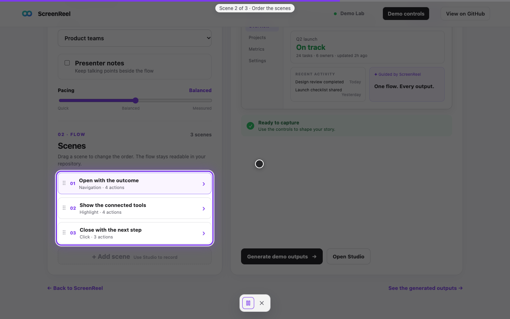
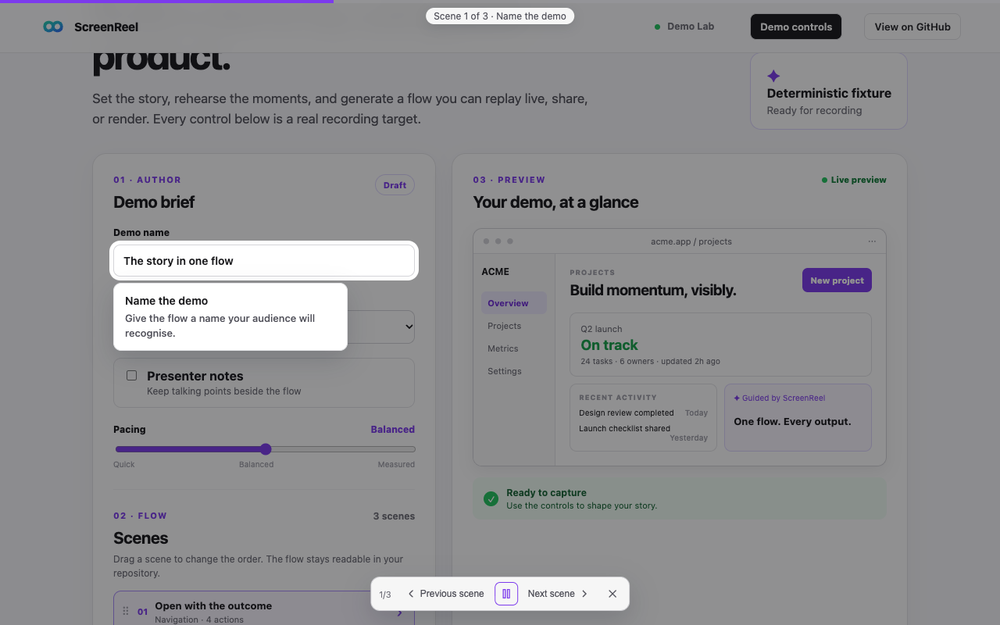
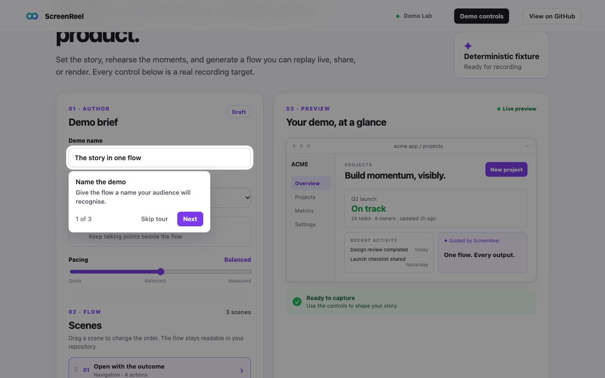
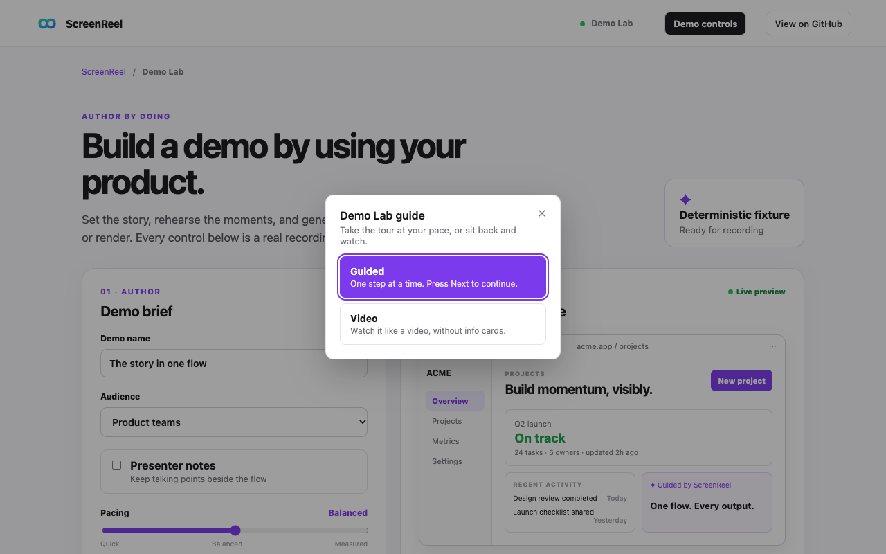
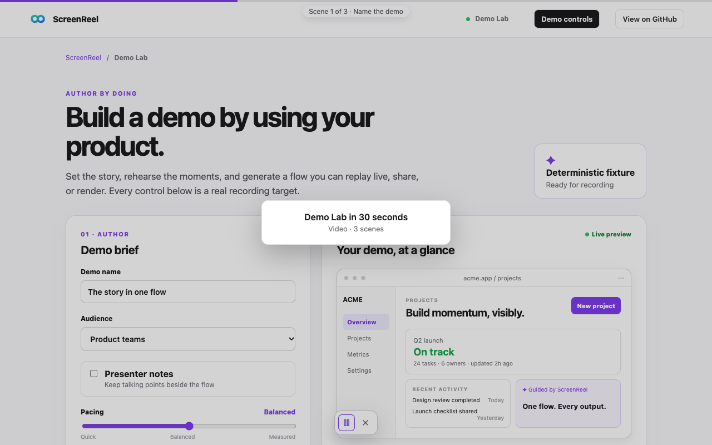
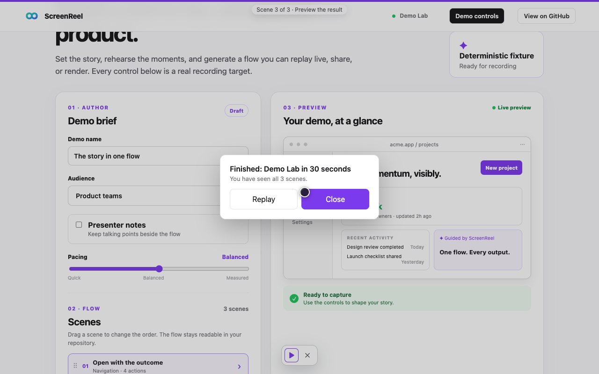
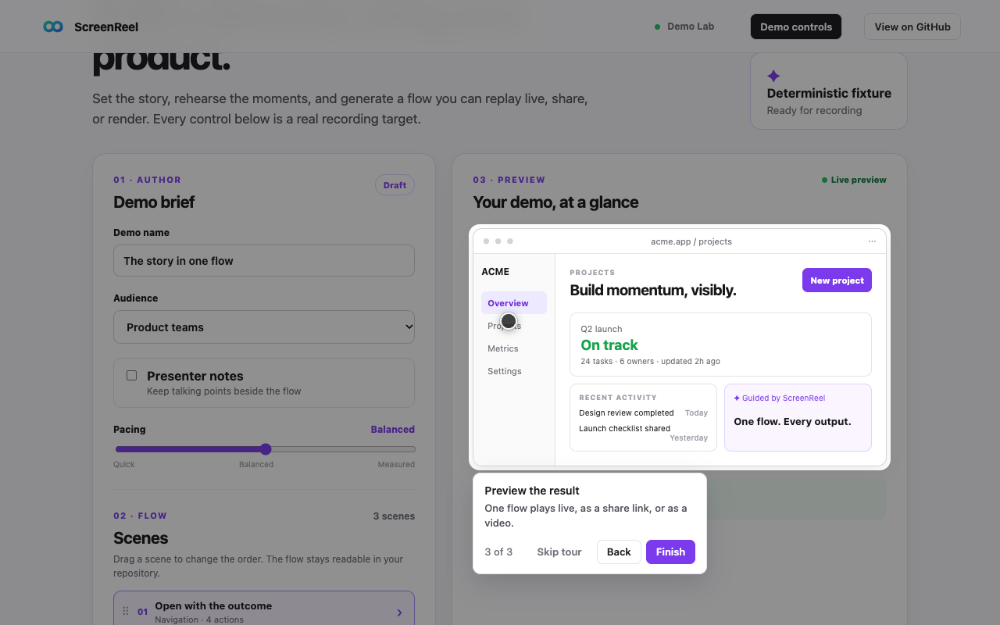
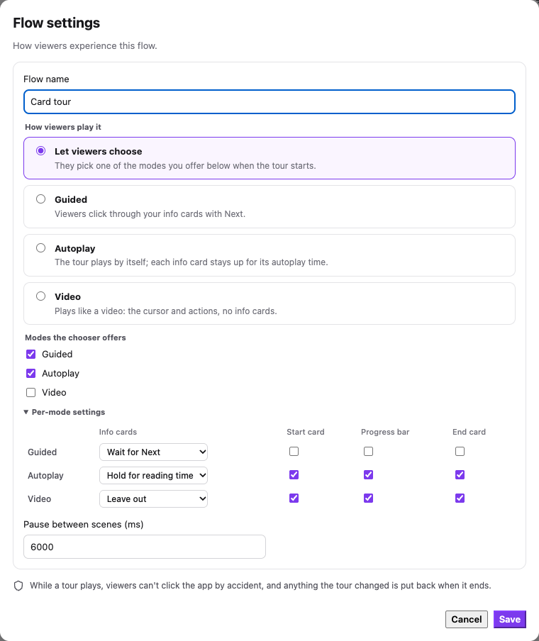
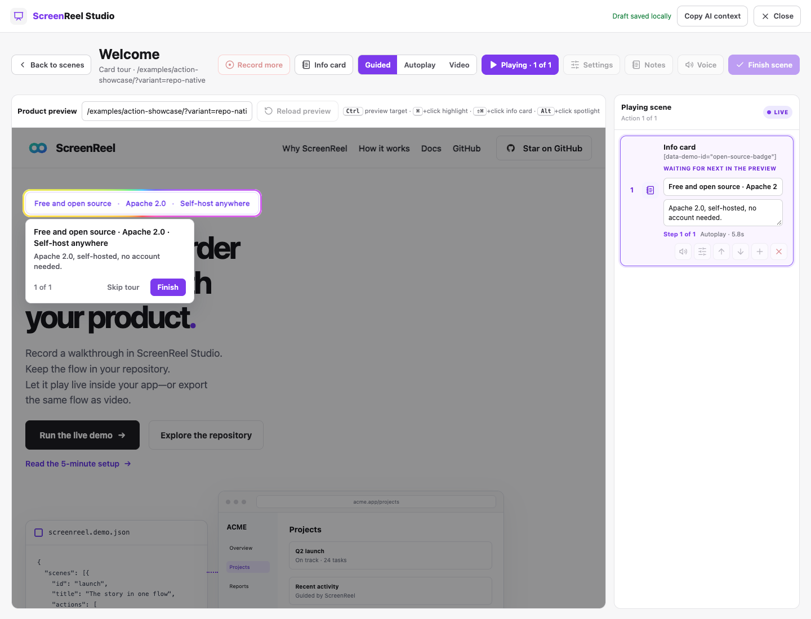

# Playback modes

Every flow answers one question: **how does it play?** ScreenReel has three answers and a way to
ask:

| Mode | The viewer… | Info cards | Start | Progress | End |
|---|---|---|---|---|---|
| `video` | watches, hands off | left out (or shown as captions) | title card | thin bar, "Scene N of M" | end card |
| `autoplay` | watches, hands off | shown, each held for its reading time | title card | thin bar + pill "1/3" | end card |
| `guided` | presses Next on each card | shown, each waits for Next | the chooser or the first card | "N of M" on the card | **Finish** on the last card |
| `ask` | picks one of the modes the flow offers | — | the chooser | — | — |

A mode is a **preset**: a named set of the lower-level settings below. A flow or a host picks a mode
and can override any of its settings.

### What each mode looks like

| `video` | `autoplay` | `guided` |
|---|---|---|
|  |  |  |

`ask` shows a chooser with only the modes the flow offers:



## Quick examples

**A video** — cursor and actions only, no cards:

```json
{ "id": "orders-film", "name": "Orders in 60 seconds", "defaults": { "playback": { "default": "video" } }, "scenes": [] }
```

**A video with captions** — the cards' words appear as a caption, with no card:

```json
"defaults": { "playback": { "default": "video", "video": { "callouts": "caption" } } }
```

**Autoplay with pop-ups** — cards show and move on by themselves:

```json
"defaults": { "playback": { "default": "autoplay" } }
```

**Guided** — the viewer clicks Next through the cards:

```json
"defaults": { "playback": { "default": "guided" } }
```

**Let the viewer choose** — a chooser offering these modes, in this order:

```json
"defaults": { "playback": { "default": "ask", "modes": ["guided", "video"] } }
```

**One guide list, each guide its own way.** The host mounts once and lets each flow decide:

```js
const projector = await ScreenReel.mount(helpButton, {
  projectId: 'app-guides',
  flow: { src: '/guides/guides.json' },  // "getting-started": ask; "whats-new": video; "first-report": guided
  loop: false, disableOnComplete: true, studio: false, position: 'center',
  playback: {
    default: 'ask',                                  // for flows that say nothing
    remember: true,                                  // focus the viewer's last pick in the chooser
    autoplay: { controls: ['prev', 'play', 'next', 'exit'] },
  },
});
await projector.start('whats-new');                     // plays as the flow says: video
await projector.start('getting-started');               // shows the chooser
await projector.start('getting-started', { mode: 'guided' }); // skips it
```

## Settings

Each mode sets every one of these. Override any of them per mode.

| Setting | Values | What it does |
|---|---|---|
| `callouts` | `'step'`, `'timed'`, `'caption'`, `'off'` | How an info card (a `callout` action) plays: wait for Next, hold for its reading time, show its words as a caption with no card, or leave it out. |
| `controls` | array of pill controls, or `null` | The pill's buttons, in display order: `flow`, `count`, `prev`, `play`, `next`, `sound`, `notes`, `studio`, `exit`. `[]` hides the pill. `null` is the older default: everything for a presenter, progress and playback for a share link. |
| `controlLabels` | boolean | Show "Previous scene" / "Next scene" text on the pill's arrows. |
| `progress` | boolean | A thin bar along the top with "Scene N of M · title". |
| `startCard` | boolean | A brief title card (the flow's name, the mode, the scene count) before the first scene. A click skips it. |
| `endCard` | boolean | An end card with **Replay** and **Close** when the flow finishes. |
| `notes` | boolean | Toast each action's `note`. |
| `narration` | boolean | Speak the narration. The viewer can still mute it. |
| `cursor` | boolean | Show the agent cursor. |
| `dim` | boolean | Dim the page behind highlights and cards. |
| `shield` | boolean | Block stray viewer clicks on the app while it plays. |
| `keys` | boolean | → or Enter for Next, ← for Back, Esc to exit. |
| `pace` | number, or `null` | The run's time scale (`1.5` is a third slower). `null` keeps the host's `timeScale`. |

### The presets

| | `video` | `autoplay` | `guided` |
|---|---|---|---|
| `callouts` | `'off'` | `'timed'` | `'step'` |
| `controls` | `play`, `sound`, `exit` | `count`, `prev`, `play`, `next`, `sound`, `exit` | none (the card has them) |
| `controlLabels` | no | yes | no |
| `progress` | yes | yes | no ("N of M" is on the card) |
| `startCard` | yes | yes | no |
| `endCard` | yes | yes | no (the last card says **Finish**) |
| `notes` | no | yes | no |
| `narration`, `cursor`, `dim`, `shield` | yes | yes | yes |
| `keys` | no | no | yes |
| `pace` | `null` | `null` | `null` |

`sound` shows only when narration is on and the browser can speak.

## Where it's configured

| Where | Shape | Use it for |
|---|---|---|
| Flow: `defaults.playback` | `{ modes, default, video, autoplay, guided }` | How this flow plays: the author's choice. |
| Mount: `playback` | `{ modes, default, force, remember, video, autoplay, guided }` | The host's house style and limits. |
| `projector.start(flowId, { mode })` | `'video'`, `'autoplay'`, `'guided'`, `'ask'` | One run, chosen by the host's own UI. |
| Scene: `advance` | `'video'`, `'autoplay'`, `'guided'` | One scene in another mode (a countdown intro that plays through in a guided tour). |

- `modes` — what the chooser offers, in order. On a flow, it defaults to `['guided', 'autoplay']`.
  On the mount, it **restricts** every flow: the chooser offers only modes in both lists, a flow
  default outside it plays autoplay if allowed, else the first allowed mode, and `start()` throws on a mode outside it.
- `default` — the mode, or `'ask'`. On the mount, it applies to flows that set none.
- `video`, `autoplay`, `guided` — per-mode overrides of the settings above.
- `force` (mount only) — the mode every flow plays, or `'ask'` to always show the chooser.
- `remember` (mount only) — keep each viewer's last chooser pick per flow, in local storage.
  `true` or `'preselect'` focuses it in the chooser; `'skip'` plays it without asking again
  (`start(flowId, { mode: 'ask' })` still asks).

Per scene, only the mode can change, and only through `advance`. A scene doesn't get its own
`playback` overrides: a pill or progress bar that changes shape mid-tour reads as a glitch.

## Precedence

**Which mode plays**, highest first:

1. `start(flowId, { mode })`.
2. The mount's `playback.force` (older: `chooser: true` → `'ask'`, then `advance`).
3. The flow's `defaults.playback.default` (older: `defaults.advance`).
4. The mount's `playback.default`.
5. `'autoplay'`.

Then:
- `'ask'` shows the chooser, except:
  - a flow that offers one mode plays it;
  - a run that cannot ask (a `?demo=play` share link, or `chooser: false`) plays `autoplay` if
    offered, else the first offered mode;
  - `remember: 'skip'` with a remembered pick plays that pick.
- A mode picked by `start()`, the chooser, or a remembered pick holds for the whole run. Otherwise a
  scene's own `advance` switches that one scene.

**Each setting**, lowest to highest:

1. The mode's preset.
2. The older look, for a run where neither the mount nor the flow uses `playback` (see
   [Migrating](#migrating-from-the-older-options)).
3. The mount's `playback.<mode>` (and the older `controls`).
4. The flow's `defaults.playback.<mode>`: the author knows the flow best.
5. The host's hard limits, which nothing overrides: `narration: false`, `cursor: false`,
   `shield: false`, `dim: false` (or `0`).

## Start, Next, Back, and the end

**Start.** The viewer always sees that something began:
- `guided`: the chooser, or the first card.
- `video` and `autoplay`: a title card, then the pill's intro beat.

**Next and Back mean different things in different places:**
- **The guided card's Next** moves to the next **step** (info card). It reads **Finish** on the
  last one.
- **The pill's arrows** move by **scene**. Their tooltips say "Previous scene" / "Next scene", and
  `controlLabels` puts the words on the pill. While a guided card waits, the pill's Next continues
  that step and says "Next step".
- **Back**, for a viewer (guided, or any mode configured with `playback`), plays the previous
  scene. It does nothing on the first scene. A presenter's pill (the older look) pauses on it.

**Pause and Play.** The pill's Play/Pause never ends the tour and the pill stays up. Inside a timed
step it holds the step in place and Play continues it; anywhere else Pause stops the scene (its
changes are undone) and Play plays that scene again from its start. The pill shows Pause as soon as
Play is pressed, while the stopped scene's cleanup finishes. **Space** presses Play/Pause in any mode
whose pill shows it (`video`, `autoplay`), whatever `keys` says, except while typing in a field, with
a modifier held, on a chooser or start/end card, or on the tour's own focused button (which Space
activates itself). One enabled projector per page takes the key.

**The pill stays on top.** The projector shell (pill, progress bar, captions) is the top of the tour
layer: rings, ripples, dims and info cards are drawn under it, so none of them cuts the controls.

**The end:**
- `guided`: **Finish** on the last card.
- `video` and `autoplay`: the end card. **Replay** starts the flow again in the same mode.
  **Close** ends the tour.

| Start card | End card | Last guided card |
|---|---|---|
|  |  |  |
- When the card times out, the tour ends only with `disableOnComplete`, as before.

Each ending is an event:

| Event | `detail` |
|---|---|
| `screenreel:start` | `{ projectId, flowId, position, mode, source }`. `source` is `'start'`, `'chooser'`, `'host'`, `'flow'`, `'host-default'`, `'remembered'`, `'restricted'`, or `'fallback'`. |
| `screenreel:complete` | `{ projectId, flowId, sceneId, position, sceneCount, mode }`. The last scene finished. |
| `screenreel:exit` | `{ projectId, flowId, sceneId, position, reason, mode }`. `reason` is `'complete'` (the flow finished and the tour closed: the end card's Close, or `disableOnComplete` after Finish or the end card), `'user'` (Skip, ✕, Esc, closing the chooser), or `'api'`. |

## Timed steps and narration audio

A **step** is an info card (a `callout`) and the actions after it, up to the next card. Give the
card a `stepMs` and the step is **timed**: its timing is a timeline stored in the flow, measured
from the moment the card shows. Audio is optional. When a step has a narration file, the file was
generated first and the timeline was copied from its word timestamps, so they match; remove the
file and the step plays with the same timing.

| Field | On | Meaning |
|---|---|---|
| `stepMs` | a `callout` | The step's total length in ms, from the card showing. Makes the step timed. |
| `narrationAudio` | a `callout` | URL of the step's narration file, resolved relative to the page like other assets. |
| `narration` | a `callout` | The file's words: its transcript, and the text a speech engine says when there is no file. |
| `atMs` | any action after a timed card, up to the next card | When the action runs, in ms from the card showing. An action without `atMs` is not part of the step (see below). |

```json
{ "type": "callout", "selector": "[data-demo-id='new-cycle']", "title": "Start a cycle", "text": "Name it and start.",
  "stepMs": 6200, "narrationAudio": "assets/guides/audio/run-cycle-03.mp3", "narration": "Start a new one. Name it…" },
{ "type": "click", "selector": "[data-demo-id='new-cycle']", "atMs": 900 },
{ "type": "type", "selector": "[data-demo-id='new-cycle-name']", "text": "SS-26 EOSS", "atMs": 2100 }
```

**Autoplay and video** play the timeline:
- The card showing starts the step's clock and, with sound on, its file from the start. The card
  does not hold for `holdMs`: it, and the ring around its target (`highlight: true`), stay up for
  the **whole step** (until `stepMs`, or the next card), however many actions run meanwhile. With
  `callouts: 'caption'` its caption stays until the step ends; with `'off'` there is no card, but
  the clock and the file still run. (A flow that wants cards in video sets
  `defaults.playback.video.callouts: 'timed'`.)
- An action with `atMs` waits until the clock reaches it, then runs as usual. One that is already
  late runs at once, and the next is still measured from the card, so lateness never adds up.
- **A gate ends the step.** The first action after a timed card that has no `atMs` (a `waitFor`,
  a `goto`, a plain `click`...) is not part of the step: the step plays out to its end first, and
  then the action runs. Actions after it with `atMs` are ignored. Put a gate (say, a `waitFor` for
  the next step's element) after the previous step's card and its actions, never between a card and
  the actions that belong to it.
- After the step's last action, the next card waits until `stepMs`, and for a file still playing
  until it ends, but never more than 1.5 s past `stepMs`.
- **The page is not dimmed while a step with actions runs.** If the step has any `atMs` action, its
  card and the actions' own highlights and spotlights draw no dim (`ctx.noDim` in the runtime), only
  the ring and the card, so a dialog an action opens is neither covered nor darkened. A step with no
  actions keeps the normal dim (the mode's `dim`) and, as ever, the card's own `dim` setting.
- **The card never blocks the page.** A timed card has `pointer-events: none`, and the actions are
  programmatic. A card that overlaps the bounding box of an element an action is working on (for
  example a button in a dialog the step just opened) fades to 35% opacity while the action runs and
  returns to full strength after it. It fades rather than moves, so it never jumps while being read;
  the check runs every frame, so a dialog opening under the card is caught too.
- A scene that ends on a timed step goes straight on to the next scene: only the scene's own
  `dwellMs` adds a rest (the flow's default dwell does not).
- `stepMs` and `atMs` are wall-clock time. The host's `timeScale` and the mode's `pace` still slow
  the actions themselves, never the timeline.

**Controls:**
- **Pause** on the pill inside a timed step pauses the clock and the file; **Play** continues both
  from where they were. An action already moving finishes; the next one waits.
- **Back** replays the previous scene, so its steps start again with the clock and file at 0.
- **Mute** stops the file; the clock keeps running, so the timing is the same with or without
  sound. Unmuting picks the file up at the clock's position.
- **Exit** stops the file.

**Guided:** a card plays its file while it waits for Next, and Next stops it. Actions run after Next
as always; `atMs` is ignored.

**Page readiness:** a scene's route, `waitFor` and `settleMs` all complete before its first action
runs, so a step's clock never starts on a page that is still loading.

**Sound without a speech engine.** The mount's `narration: { speech: false }` plays narration files
only: no browser speech, so a step without a file is silent. `narration: false` still turns all
narration off, files included. A scene with any narration file is never also spoken from its
`narration` or `talkingPoints`.

**Measuring drift.** `screenreel:step` carries the clock: `stepMs` (the step's length), `atMs` (the
action's offset, or `null`), and `elapsedMs` (the step clock when the action starts). `elapsedMs -
atMs` is how late an action ran. Outside a timed step all three are `null`. Pausing and resuming a
timed step fires `screenreel:hold` with `{ held, stepMs, elapsedMs, paused, running }`.

**Checking it.** `validateScene()` reports a card's `stepMs` that is not a positive number,
`narrationAudio` on an action that is not a card, `atMs` with no timed card before it or after the
gate that ended the step, `atMs` past its step's `stepMs`, and an `atMs` earlier than the action
before it. Studio's pacer never stretches a timed step: its timeline is
authoritative.

## What merged, and what stayed separate

The old options mixed three questions: *what plays* (mode), *how it looks while it plays*
(settings), and *where it lives on the page* (host). Only the first two belong to playback.

| Older option | Now | Why |
|---|---|---|
| `advance` (mount, flow, scene) | the **mode**: `playback.force`, `defaults.playback.default`, scene `advance` | It already named the mode. Scene `advance` stays, with the new names. |
| `chooser` | `'ask'` plus `modes` | A chooser is a mode choice, and `modes` says what it offers. |
| `controls` (per mode) | the preset's `controls` setting | The pill's buttons depend on the mode. |
| `narration: true/false` | the preset's `narration` | Whether a mode speaks is a playback choice. The mount's `narration: { rate, voiceName, lang }` still configures the voice, and `narration: false` still turns it off everywhere. |
| action `note` toasts | the preset's `notes` | A guided card already carries the words; a video wants none. |
| `cursor`, `dim`, `shield` | preset settings and host limits | A mode can drop them; a host's `false` stays a hard off. `cursor: 'dot'/'arrow'` (the glyph) and `dim: 0.45` (the strength) stay mount options. |
| presenter pill vs. guided card | `controls`, `controlLabels`, `callouts` | Both are now settings of a mode, not two players. |
| `notesMode` | **separate** | It is page layout (reserve space below the page or overlay it) for presenter notes, not how the flow plays. |
| `position`, `studio` | **separate** | Where the pill sits and whether authoring is offered belong to the host page. |
| `loop`, `disableOnComplete`, `restoreOnExit` | **separate** | Lifecycle: what happens around a run, the same in every mode. |
| `activationQueryParam` | **separate** | How the page turns ScreenReel on, before any flow plays. |

## Migrating from the older options

Nothing breaks. The older options keep working and map onto the model. Each logs a one-time
`console.info` naming its replacement.

| Older | Maps to |
|---|---|
| flow `defaults.advance: 'auto' / 'guided' / 'ask'` | `defaults.playback.default: 'autoplay' / 'guided' / 'ask'` (read when `playback` has no `default`) |
| mount `advance: 'auto' / 'guided'` | `playback.force: 'autoplay' / 'guided'` |
| mount `chooser: true` | `playback.force: 'ask'` (beats `advance`, as before) |
| mount `chooser: false` | never ask: an `'ask'` flow plays autoplay |
| mount `controls: [...]` | `playback.<every mode>.controls` |
| mount `controls: { guided, auto }` | `playback.guided.controls`, `playback.autoplay.controls` |
| mount `shield: false`, `narration: false`, `cursor: false`, `dim: false` | hard limits over every mode |
| `start(id, { mode: 'auto' })` | `start(id, { mode: 'autoplay' })` |
| scene `advance: 'auto'` | scene `advance: 'autoplay'` |

**A run configured only by older options looks exactly as before:**
- the presenter or share-link pill;
- no start card, end card, progress bar, or pill text.

The new look starts when the mount or the flow uses `playback`. Note one change: the chooser's
autoplay button is now `data-choose="autoplay"`, no longer `"auto"`.

Studio writes both `defaults.playback` and `defaults.advance` (`video` → `'auto'`), so an older
runtime still plays a flow Studio saved.

## Checking it

`screenreel flow validate` and `screenreel flow doctor` report a `playback` entry per flow:
- **Errors** (they fail the run): an unknown mode, `'ask'` in `modes`, a `default` that `modes`
  excludes, an unknown setting or value, a mount-only key on a flow.
- **Warnings:** a flow that can play guided has an enabled scene with no info card. A guided viewer
  watches that scene play through with nothing to press Next on. Another warning: `advance` and
  `playback.default` disagree.

The same checks are `ScreenReelPlayback.validateFlowPlayback(flow)` in the browser, and the
manifest schema (`dist/projector/screenreel.schema.json`) describes `defaults.playback`. Projector
warns in the console about a bad mount `playback`.

In **Studio**, **Flow settings** sets:
- the default mode;
- the modes the chooser offers;
- per mode: how info cards play, the start card, the progress bar, and the end card.

**Play scene** previews the scene as Guided, Autoplay, or Video.

| Flow settings | Play scene preview modes |
|---|---|
|  |  |

## Labels

Every string is in `labels`, for translation:
- **Chooser:** `video`, `videoHint`.
- **Pill:** `previousScene`, `nextScene`, `nextStep`, `play`, `pause`, `exit`.
- **Progress bar:** `sceneOf(scene, total)`.
- **Start card:** `startHint(mode, scenes)`.
- **End card:** `finished`, `endHint(scenes)`, `replay`.

These are added to the existing guide labels. See [Guided tours](guided-tours.md).

Theme the new pieces with `--sr-progress-height`, `--sr-progress-track`, `--sr-caption-background`,
`--sr-caption-foreground`, and `--sr-card-backdrop` (see [Theming](theming.md)).
